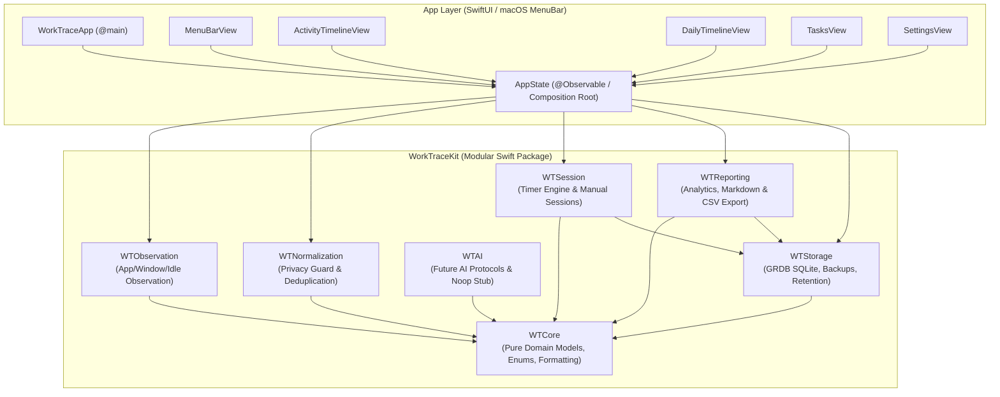
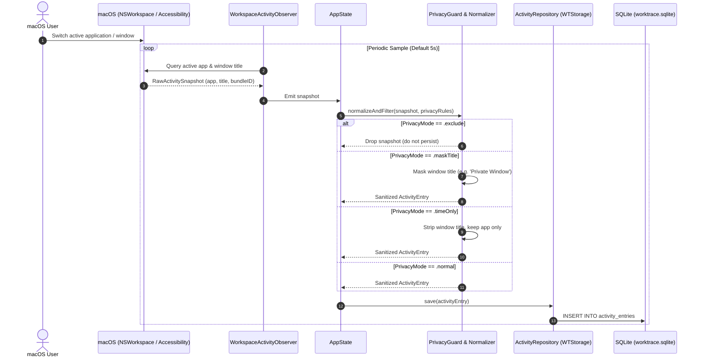
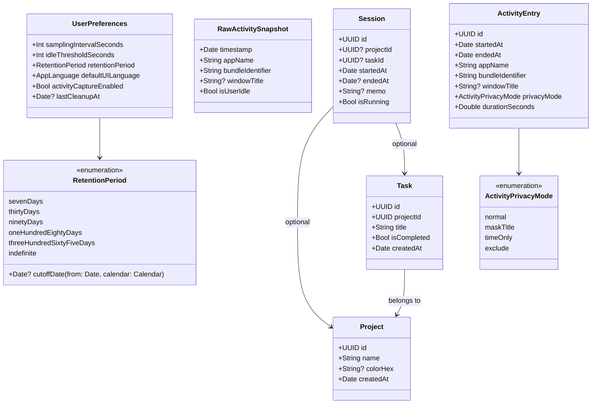

# WorkTrace

[](https://github.com/sofardogood/WorkTrace/actions/workflows/ci.yml)
[](LICENSE)
[](#requirements)
[](#requirements)
[](#quality-baseline)

## Overview / プロジェクト概要

**WorkTrace** は、プライバシー保護とローカルファーストを徹底追求した macOS 向けアクティビティトラッカー＆作業時間分析アプリケーションです。
バックグラウンドでフォアグラウンドアプリケーションおよびウィンドウタイトルを自動観測し、ユーザーが「何にどのくらい時間を使ったか」を透明かつ直感的に把握できる環境を提供します。

多くの作業ログ・タイムトラッキングツールが抱える「クラウドへの行動データ送信」「手動タイマー運用の煩雑さ」「機密情報を含むウィンドウタイトルの無差別保存」といった課題を解決するため、**ディスク書き込み前のプライバシー正規化（マスキング）**、**完全ローカル SQLite 保持**、**設定可能な自動保持期限（デフォルト7日間）** をコア設計原則として開発されています。

> **English Summary:**
> **WorkTrace is a privacy-first, local-only activity tracker for macOS.** It automatically observes foreground applications and readable window titles, visualizes your productivity and focus patterns (composition, rankings, chronological timeline, and trends), and guarantees that your raw behavior data remains exclusively on your Mac with pre-persistence privacy protection.

---

## Key Differentiators / 主な特徴

- 🔒 **Privacy-by-Design（保存前マスキング）**: 機密性の高いウィンドウタイトルや除外対象アプリのデータは、ディスク（SQLite）へ書き込まれる前に `WTNormalization` レイヤーでマスクまたは除外。マスクされたデータは復元不可能です。
- 💻 **100% Local Storage（完全ローカル保存）**: クラウド同期やサードパーティ製分析サービスへのデータ送信は一切行いません。データはすべて `~/Library/Application Support/WorkTrace/worktrace.sqlite` に保存されます。
- ⏳ **Automated Data Lifecycle（安全なデータライフサイクル）**: デフォルト保持期間は7日間（7日、30日、90日、180日、365日、無期限から選択可能）。自動パージ前には日次バックアップが作成され、監査ログに実行結果が記録されます。
- 📊 **Multidimensional Analytics（多角的な作業分析）**:
  - アクティブ / アイドル比率やアプリ別比率を示すドーナツチャート
  - アプリ・ウィンドウの利用時間水平ランキング
  - アイドル時間ギャップを含むガントチャート風タイムライン
  - 過去7日間の推移を把握できるトレンドグラフ
- ⏱️ **Manual Sessions & Reporting（手動計測＆レポート）**: 自動追跡に加え、プロジェクト・タスクに紐づく手動タイマー（一時停止、再開、クラッシュ復旧対応）、Markdown および CSV でのエクスポートを標準装備。
- 🌐 **Full Bilingual Support（日英完全対応）**: UI・生成レポートともに日本語・英語を完備。
- 🚫 **No Surveillance**: スクリーンショット撮影やキーストローク記録（キーロガー）は一切行いません。

---

## Architecture & UML Diagrams

WorkTrace は責任分離とテスタビリティを担保するため、レイヤードアーキテクチャ（Swift Package `WorkTraceKit` + ネイティブ SwiftUI `App`）を採用しています。

### 1. Component Architecture Diagram（コンポーネント構成図）



### 2. Activity Capture & Privacy Sequence（データキャプチャ＆プライバシーフロー）

フォアグラウンドアプリケーションやウィンドウタイトルが観測されてから、マスキングを経て SQLite へ保存されるまでのシーケンスです。



### 3. Core Domain Class Diagram（ドメインモデル クラス図）



---

## Detailed Capabilities / 機能詳細

### 1. Automatic Activity Review（自動アクティビティ追跡・分析）
- フォアグラウンドアプリおよびウィンドウタイトルの自動追跡
- 今日の利用状況および直近7日間の集計ビュー
- アクティブ時間・アイドル時間・アプリ切替回数・Topアプリ/Topウィンドウのサマリーカード表示
- Overview、Applications、Windows & Screens、Timeline、Trends の5つの視点
- アプリケーション、ウィンドウ名、マスキング状態に応じたリアルタイム検索・フィルタリング
- WorkTrace 自体の利用時間は全体生産性サマリーから自動除外（詳細行には保持）

### 2. Privacy & Data Lifecycle（プライバシーとライフサイクル管理）
- **保存前マスキング**: プライバシールール（除外・タイトルマスク・時間のみ記録）はディスク保存前に適用され、マスク後の値から元データを復元することは不可
- **自動データ保持期間**: 7日（デフォルト）、30日、90日、180日、365日、または無期限
- **自動日次バックアップ**: クリーンアップ実行直前に自動で SQLite バックアップを生成
- **監査ログ（Audit Log）**: データ削除や設定変更の履歴を SQLite 内に保持

### 3. Manual Organization & Export（手動計測＆レポート出力）
- プロジェクト／タスク別の手動タイマー（開始・一時停止・再開・終了・メモ入力）
- アプリ再起動やクラッシュ時の中断タイマー復旧（Crash Recovery）
- 決定論的 Markdown レポート生成および CSV エクスポート機能
- 日本語・英語の両言語でのレポート生成対応

### 4. Quality Baseline（品質保証とテスト）
- **90 の自動テスト**: プライバシーマスキング、データ保持クリーンアップ、GRDB マイグレーション、バックアップ、分析集計、CSV/Markdown 出力、タイマー状態遷移を網羅
- **XcodeGen**: `project.yml` からクリーンかつ再現可能な Xcode プロジェクトを生成

---

## Privacy Model / プライバシーモデル

WorkTrace は macOS の **アクセシビリティ権限（Accessibility permission）** をアクティブウィンドウのタイトル取得のためだけに使用します。
アクセシビリティ権限を付与しない場合でも、アプリケーションの利用時間記録はそのまま動作し、ウィンドウタイトルのみが記録から除外されます。

- スクリーンショットやキーストロークの取得は行いません
- アカウント作成やクラウドログインは不要です
- 外部へのテレメトリ送信は一切含まれません

ローカルデータベースの保存場所:
```text
~/Library/Application Support/WorkTrace/worktrace.sqlite
```
*※パブリックな Issue やサポートフォーラムに上記データベースファイルや生ログを添付しないでください。*

---

## Requirements / 動作環境

- macOS 26.5 以上
- Xcode 26.5 以上
- Swift 6.0 ツールチェーン
- [XcodeGen](https://github.com/yonaskolb/XcodeGen)

XcodeGen のインストール:
```bash
brew install xcodegen
```

---

## Build and Test / ビルドとテスト

```bash
git clone https://github.com/sofardogood/WorkTrace.git
cd WorkTrace

# Xcodeプロジェクトの生成
xcodegen generate

# パッケージテストの実行 (90 tests)
swift test --package-path WorkTraceKit

# アプリケーションのビルド (macOS arm64)
xcodebuild \
  -project WorkTrace.xcodeproj \
  -scheme WorkTrace \
  -configuration Debug \
  -destination 'platform=macOS,arch=arm64' \
  build
```

> **Note:** 生成される `WorkTrace.xcodeproj` は `.gitignore` に含まれており、リポジトリにはコミットされません。クローン時や `project.yml` 変更時には `xcodegen generate` を実行してください。

---

## Module Breakdown / モジュール一覧

| モジュール | 責務 / 役割 | 依存関係 |
|---|---|---|
| `WTCore` | ドメインモデル（`ActivityEntry`, `Session` 等）、設定、保持期間、フォーマッタ、監査型定義 | なし（Pure Swift） |
| `WTStorage` | SQLite マイグレーション、GRDB レポジトリ、日次バックアップ、保持クリーンアップ、監査記録 | `WTCore`, `GRDB` |
| `WTObservation` | `NSWorkspace` によるフォアグラウンドアプリ、アクセシビリティによるウィンドウタイトル、アイドル監視 | `WTCore` |
| `WTNormalization` | 保存前プライバシーマスキング（`PrivacyGuard`）、重複排除・データ圧縮 | `WTCore` |
| `WTSession` | 手動タイマーステートマシン、クラッシュ復旧、セッション編集 | `WTCore`, `WTStorage` |
| `WTReporting` | アクティビティ集計・分析、フィルタリング、日英 Markdown レポート生成、CSV エクスポート | `WTCore`, `WTStorage` |
| `WTAI` | 将来のローカル AI 統合用プロトコルおよび No-op スタブ（現時点で外部 LLM 依存なし） | `WTCore` |
| `App` | メニューバー常駐型 SwiftUI アプリケーション、設定画面、オンボーディング、タイムライン UI | `WorkTraceKit` 全モジュール |

---

## Documentation & Maintenance / ドキュメント

- [Contributing Guide / コントリビューションガイド](CONTRIBUTING.md)
- [Security Policy / セキュリティポリシー](SECURITY.md)
- [Changelog / 変更履歴](CHANGELOG.md)
- [Roadmap / ロードマップ](ROADMAP.md)
- [v0.1.0 Release Notes / リリースノート](RELEASE_NOTES_v0.1.0.md)
- [Manual QA Checklist / 手動テストチェックリスト](docs/QA_CHECKLIST.md)
- [Manual QA Execution Plan / QA実行計画](docs/QA_EXECUTION_PLAN.md)
- [QA Notes / QA実施記録](docs/QA_NOTES.md)
- [Issue Tracker](https://github.com/sofardogood/WorkTrace/issues)

---

## Release Status / リリース状況

`v0.1.0` は最初のパブリックリリースのベースラインです。署名および公証済み（Notarized）のバイナリ配布が準備されるまでは、ソースコードからのビルドが推奨される利用方法となります。

---

## License

WorkTrace is released under the [MIT License](LICENSE).
